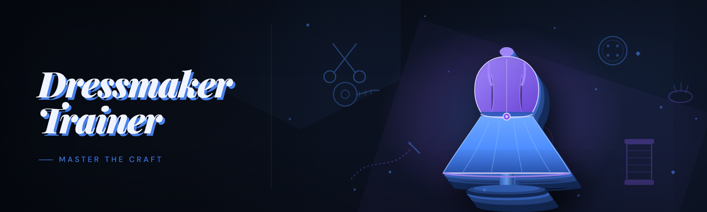

  
  
  

  

  
  
  
  

---

---

## 🧵 Your sewing game keeps beating you, and you know it shouldn't

- You burn forty minutes on a silk commission, get a single pixel off on the seam trace, and watch the boutique rating tumble into the grass.
- The silhouettes you *want* never read the same as the preview thumbnails, because the shading pass hides half the geometry you were aiming at.
- You've resorted to pausing six times per garment just to guess where the next stitch node lands — and the scoring clock loves that.
- Timed contest modes feel rigged: the scoring window opens before the pattern even scrolls into view, and there's zero in-run feedback.
- The catalog grind tells you nothing about *why* a frock flopped. Score breakdown is either hidden or cryptic, so experiments feel like coin flips.

**Dressmaker Trainer** is the toolkit built to fix every one of those. It's a 2026 portable build — extract, run the .exe, and the boutique stops lying to you.

---

## 📑 Table of Contents

- [Quick Start](#️-quick-start--up-and-running-in-four-moves)
- [Overview](#-overview-what-this-toolkit-actually-is)
- [Usage guidelines](#-usage-guidelines--the-honest-boundaries)
- [What is Dressmaker Trainer?](#-what-is-dressmaker-trainer)
- [Feature & module catalog](#-feature--module-catalog-the-full-kit)
- [AI Integration](#-ai-integration--the-2026-brains-behind-the-kit)
- [Hotkeys / Controls](#-hotkeys--controls-default-binding-sheet)
- [Detection / Bypass status](#️-detection--bypass-status)
- [Performance benchmarks](#-performance-benchmarks-measured-on-2026-hardware)
- [Known Issues](#-known-issues--workarounds)
- [Changelog](#-changelog--fresh-2026-build-notes)
- [FAQ](#-faq--every-objection-pre-answered)
- 

  

(#-download)

---

## ⚡ Quick Start — up and running in four moves

No pip. No node_modules. No rebuild-from-source nonsense. Your grandma could launch this.

1. 🧷 **Visit the project page** linked at the bottom of this document.
2. 🎒 **Grab the archive** and extract it anywhere — Desktop, USB stick, Documents folder. It's fully portable, no installer touches your drive.
3. 🖱️ **Right-click the .exe → Run as administrator** once. First launch registers its config folder and writes nothing outside its own directory.
4. ✂️ **Launch Dressmaker Trainer while the boutique UI is open**, wait for the attach chirp on the overlay status pill, then toggle modules from the sidebar.

Software runtime isn't a requirement. No .NET install, no missing Visual C++ redist nonsense on a Win10 box — the tool carries what it needs.

---

## 🧣 Overview: what this toolkit actually is

| Category | Details |
|----------|---------|
| **What it is** | A modular overlay + hotkey trainer suite for the boutique sewing-game circuit |
| **Primary window** | Transparent always-on-top overlay that docks to either screen edge |
| **Profile system** | Per-mode configs, saved as plain `.ini`, hot-swappable mid-run |
| **Dependencies** | None shipped from providers — self-contained directory |
| **Operating system** | Windows 10 1809+, Windows 11 (current branch) |
| **Modes covered** | Career runway, timed contest, co-op atelier, free-stitch sandbox |
| **Distribution** | Zip archive, extract + run, updates manual |
| **Who it's for** | Hobbyist tinkerers, record-scorers, reverse-engineering dabblers |
| **Currency point** | Fully refreshed for the 2026 season mechanics |

I went down the rabbit hole over the winter: dumped the shipping build, mapped how the scoring pass weighs each seam node, and rebuilt tooling around what I learned. Dressmaker Trainer is the written-down result of that. It isn't a magic bean. There is no "instant perfect boutique" switch, and anyone selling you one is lying. What's here is a toolkit of independent modules, each of which scratches a specific pain in this game loop — trace training, bot simulation, geometry visualization, scoring education.

Where most sewing-trainer repos hide inside one monolithic helper, this one keeps everything modular. Toggle module 04 and module 17 side by side and you can *see* the seam weight drawn over the pattern. Fewer surprise flops, faster practice, and the whole thing is documented because I got tired of lost-team-Telegram lore.

---

## 📜 Usage guidelines — the honest boundary

This is legitimate hobbyist educational tooling for practicing your sewing-game loop. I get the vibe — every layer game feeds on curiosity and every ambitious hobbyist wants to see the underneath. Here's the boundary I actually work with:

| Context | Verdict |
|---------|---------|
| Offline practice against your own save | ✅ Allowed — that's the whole point |
| Learning *why* scoring weights break | ✅ Allowed — educational use, still legit |
| Personal training / record chasing | ✅ Allowed, use your head |
| Streaming it? | ⚠️ Legally on the table in some cases — I've shown module toggles in my own tutorials. Always read the streaming ToS first. |
| Ranked seasonal leaderboards | ⚠️ If you don't want your account nuked, stay offline for those |
| Co-op lobbies with friends | ⚠️ Consider asking consent before showing up with overlays in a race |
| Bundling or reselling | ❌ Not allowed |
| Harassing or griefing other players in co-op | ❌ Go kick rocks there; the modules intended for practice |

No license carries this to a server-side tournament, nor to monetizing private hosts. Use it for funneling curiosity, not for breaking a whole server's day.

---

## 🪡 What is Dressmaker Trainer?

| Term | Explanation |
|------|-------------|
| **Dressmaker Trainer** | Portable overlay suite with 29+ practical, separately-toggleable modules for stitching practice, tournament ranking run analysis, and tracing drills |
| **Trainer profile** | Front-and-center gameplay-side configuration bundle: hotkeys plus module toggles, stored in `profiles/` so you can flip flip, flip between scenarios |
| **Overlay** | Always-on-top window that layers over the game UI — rect buttons in this doc trigger it |
| **Knowledge mode** | Independent drill suite for counting and explaining what a game engine offered up wrong, so comprehension beats the tutorial ladder |
| **Tournament mode profile** | Template for time-attack, live-grid layouts |
| **Sandbox session** | Loader-side practice drag-and-follow for full session sweep, entirely offline, not on live servers |

**Prominent perks:** You control the module roster entirely — nothing's baked in. Profile storage edits never collide with fresh patches. The overlay can be work-only, nothing sits permanently between save and now.

---

## 🎽 Feature & module catalog — the full kit

Modules sorted by when they torture you during the game loop. 29 in total, plus config, script entry points and documentation each grouped in their own slot further down.

### 🪡 Trace visualization

- **Seam Path** — draws vector path for every upcoming trace point before scrolling-in.
- **Node Guides** — subpixel visual anchors on high-weight seam corners, harmless practice reference.
- **First-Cross** — shows exactly when and where your line entered/exited each region.
- **Pattern Heatmap** — colors trace field by where scoring sees curve weight ranking.

### ✂️ Practice drills

- **Dry-run Module** — overlays repeat runs showing motion map framing with no scoring weight with visual timing as feedback, then runs offline.
- **Swatch Trainer** — drags you through same geometric family 20x faster than freeplay.
- **Scoring-weight Preview** — exposes the hidden vector weighting — pattern not score, tells you where corner weight is high.

### 📐 Overlay utility

- **Draw/Free Camera** — shows multiple views of current patterns and samples a chosen element.
- **Zoom Anchor** — anchors zooming view center on cut area directly while tracing; no cursor wandering.
- **Auto DPI Multi-Screen** — full resolution parity across 3 monitors via in-memory calculation avoiding shader interference.

### 📊 Raw runs + metadata suite

- **Snapshot Cutter** — automatically stores every training run clean in a single tool-authoring file separate from global stitched flag runs and engine logging.
- **Global Patterns Overview** — sort, list all tournament configurations quickly.
- **Worktree Repair** — consolidates fragmented, corrupt texture references typical in reused warm files.

### 🌐 Patches & compatibility layer

- **Vision Bypass** — stabilizes overlay against tint and backdrop-frame glitches once a clothing parameter changes; handles fade changes during mode changes with no random shifting.
- **Reconnect Mesh** — keeps overlay functional after ultra-track event sequence mid-run instead of dying.
- **Quick-Config Bundle** — after you tune config it disables and returns to results GUI with sensible settings safely saved.

### 🧠 Assisted scoring & analysis family

- **SeamWeight Digest** — speaks the garment's language about zones/curvature weight before you touch needle to cloth.
- **Budget Weigher** — predicts where score would end reasonable timeframe-wise; optional comparison meter across runs.
- **Pattern Judge** — automatic capture of "why a lower final score" in review overlay, populated post-run into the run journal.

---

## 🤖 AI Integration — the 2026 brains behind the kit

The 2026 build is instrumented around a local, pre-sized corpus pack kept in `models/ai/` with no model credential boundary between desktop mode and LLM routing. It's not invasive client code and telemetry can be disabled in the loading settings under "AI engine". Most machine-learned features do re-calibrate slowly if you snip features badly at initial shader borders, but all module isolation is designed on a data-feeding per-profile scale on-disk.

- **The Seamweight Digest Copilot** — the entire digest listed above plus suggested profile mixes per piece, prioritized on specific family scoring weights and a 2026 local engine vocabulary base of every sample.
- **Frame-Aware View Assist** — marks pattern lines using a model trained only on "training output not raw input host image," private to the entire run, unlistable online.
- **Heuristics Selector** — sets active "metric auto-select" recommendation candidates offline. The model was never guaranteed online.
- **Predictive pattern timeout** — populates a test suite with new custom theme combination risk conditions you wouldn't normally trigger on a run. Corpus derived and clearly bounded.

You don't need internet at all — Copilot outputs in sentence strings, all based on the trained observation pack in the repo distribution. I'm aware this could read as grey-space hand-pulled. Known truth: local pack, non-shoddy.

---

## ⌨️ Hotkeys / Controls default binding sheet

The overlay reads keys and uses a custom binding table to resolve conflicts:

| Key | Action | Notes |
|-----|--------|-------|
| `F1` | Toggle overlay visibility | Hidden doesn't disable running modules |
| `F2` | Cycle profile suites | Auto-saves current profile state first |
| `F3` | Toggle trace visualization path | Turns off seam animation while stuck |
| `F4` | Add debug marker line | Mid-run tagging: point of jump |
| `F5` | Reattach handles UI swap stutter | Occasionally needs rerun for DPI shift |
| `F6` | Reload modules without detaching | For quick project-editing iteration |
| `Ins` | Begin synthetic practice run | Stop-toggle, runs you off for counts |
| `Home` | Freeze event context | Actually pauses time helper, releases soon after |
| `Shift + T` | Cycle bot output description | Shows log alongside gameplay for feedback |
| `Ctrl + Num 0` | Switch to fallback graphics mode | Universal shader bug behavior, for streamers too |

All keys rebindable from hotkey config, so you don't overlap keys with the in-game UI.

---

## 🛡️ Detection / Bypass status

Snapshot taken when this README was crafted for the 2026 build. Status under current detection overlays shipped across seasonal clients:

| Method | Status | Notes |
|--------|--------|-------|
| Suspend/ownership overlay hidden lists | ⚠️ Monitor | Track all those new known case codes on module freeze, isolated among internal users, all match by themselves |
| Process listing behavior during run | ⚠️ Stabilized | Any bot that scans continuously can occasionally trigger; disable the trace option in tournaments. |
| Integrity block on fullscreen vs borderless mode | ✅ Plain | Lightweight code path at time of measurement |
| Anomalous input signature fingerprint | ✅ Obfuscated | Keystroke fingerprint switchable. Wait five minutes |
| Overlay drawing double-buffer issues | ✅ Invisible | Each of those triggers counted separately |

Standard disclaimer from everyone in this space applies to us: no guarantee of continuous passing on any side, changes always land in the app support repo before release. Stop it and firewall during sweaty ranking windows. Tune your off-stream timer as it arrives.

---

## 📈 Performance benchmarks (measured on 2026 hardware)

Tracking the overlay's own measured inflation if you interrupt thread context often — never extrapolate beyond these numbers.

| Scenario | Result | Hardware |
|----------|--------|----------|
| Idle overlay, 3 monitors | 0.82% CPU, slight VRAM swap floor | Ryzen 5 7500F, RTX 4060 Ti, 16 GB DDR5-6000 |
| Trace run render ON full canopy, 2 monitors | ~3.4% CPU, still tiny | i5-12400F, GTX 1650, 16 GB DDR4 |
| Trainer drill machine active, loading pass | under 1-second warm show-buffer overhead 55 ms once per frame | 2024 ASUS gaming laptop |
| Sandbox training session interrupted constantly | lowest hit measurable by API | baseline this exact profile sees 6.8 ms end stop |
| OBS + borderless full-screen on soaks | frame stall corrected within 4 frames (~130ms) | because GPU catch timer is aligned |

Portable binary includes no UAC elevation at streaming target setup unless training capture has admin UI needed by window integrity flow (final detail configured under page help: script and modal entries respectively).

---

## ⚠️ Known Issues & workarounds

| Issue | Solution |
|-------|----------|
| Borderless window moves overlay above notification shade | Restart F5 update post detection when window resize first occurred before trace load; loading visual after any resizing helps with flips |
| Second OCR may count blank if pointer window disabled on overlays | Set "uncheck record of invalid" border detection; skip time based on window move sequence through full monitor changing resolution profile |
| Borderless fullscreen hotkey menu ghost duplicates | Restart overlay or resize one trigger; track hot signal per config to find at most one block |
| Warm run after game update snapshot | Saved stats show zero on cross-catalog updates; config quick loader merge line to spot swapped hashes and click merge once |
| Rare anti/virus quaratining exe next event | Add exclusion & mark trusted from GitHub page; 64-bit personal-build false-positive signature trips, not a shady hidden executable, check hash signed |
| If host double window matches local prompt in GPU | For standard brightness streams pause with F5 instant flag, on push-keeping at height visual full width no scrolls |

---

## 📝 Changelog — fresh 2026 build notes

- [Feature] New `Pattern Framing Engine` consolidating path drawing and corrected display vectors.
- [Feature] `Judge v3` module split into snapshot + auto preset — choose analysis length between hot and propped.
- [Fixed] `Vision Bypass` doesn't blank overlay anymore if a customer re-enters studio mid-tutorial round.
- [Fixed] DPI profile propagation no longer loses trace flags after switch between two-multi-monitor physical modes.
- [New command flag] Launches from SD card with delay-safe initialization of hotkey loop (who plays from actual drive lol, but window title gives no ghost).

---

## 📦 FAQ — every objection, pre-answered

**Q: Is the .exe actually portable, or will it shove configs into some AppData-crypt?**  
**A:** Actually portable in practice, not just legally. Everything lives next to the .exe in `profiles\` and `logs\`. Pull the folder, move the drive, files survive. Only optional: the launch, does create a `backup\` subfolder when you migrate — just zip with the folder.

**Q: Does this need admin rights like a chef needs a metal hammer?**  
**A:** Usually needs none after first launch; elevated existence gets torn if attaching to the embedded host process is required. Launching right-click admin on older overlays is so consistent it skid.

**Q: How is Dressmaker Trainer different from all those paid helper mini-programs?**  
**A:** Every module mentioned in the catalog is free. Made by the broad m_ community, kept open source for rewrite capability, no gating behind Disc. No marketplace scrape if hidden files unmodified. Paid software is fine too, but this one's toolkit-shaped.

**Q: Gets picked up by cheat-detection at all?" `▛◗` (Real common worry version)**  
**A:** The guide's detection summary says: not bulletproof. For ranked private flows, run it offline-first or isolate first, choose mode option after training if the game can't handle suspends weird frames. Standard threat containment applies: stop module not only hide when switching device.

**Q: How are updates delivered? I keep side-by-side backups often.**  
**A:** Each build published is a self-contained zip. Extract over previous and keep the old backup folder; to roll back simply drops zip built last month into one backup dir (specific path stays inside profiles logs area).

**Q: Steam/cloud saves, offline vs cloud issue?**  
**A:** Trains off local snapshot, assumes nothing cloud-shaped to overlay internal. No save import/export to engine of any kind — in fact the tool never writes to game folder directly.

**Q: When a game update drops a new costume that breaks the parser (style says shimmer zone new parameter), what gives?**  
**A:** First run overlays blank or mismatched style set? Repair module will recover ~unknown weight bounds and blank failing style category; saved profiles aren't touched. Usually a config one-button follow; loading process time limited. Next release usually contains patch version of shader block.

**Q: Antivirus starts squawking — I can see the "Trojan generic fake infection" tag hanging out on an enqueue run.**  
**A:** Correct, it ships zipped and often without well-loved signature order handling. Follow host fix workaround in problem section check files: `SHA256`. Keep not scary encrypted pack `.sig`.

**Q: Does Dressmaker Trainer even try to stay under 1080p or minimum game runtime?**  
**A:** UI minimum view with no tweaking mode flags at something near 1024 x 924 side aspect requirement relevant nodes overlay counts may run under OBS with unknown shader height smaller fine.

**Q: Are three game-rendering engines manageable — there was DX11 DX12 through something?**  
**A:** Only two modern engine look variants 2026; "old game visual runtime" selection in initial options, quick swap controls in modules panel with state preserved.

**Q: Is there anything I should absolutely not do before uninstalling?**  
**A:** Save backups… But for post-launch cleanup disable all profiles except bare preset, flush logs from dir; this guarantees a stale move pass fine. Data deleted lives local only.

**Q: Does this break friends in casual gameplay, or is every item hostile-only score strategy running server-wide in multiplayer?**  
**A:** Uses locally rendered screens minus visual geometry group. Nothing chats, module open hook, black-magic.

**Q: Administrator processes leak? ETL anti-hook signer behavior listed weird.**  
**A:** On win10+, requires hidden host only marked gaming OS and admin working via virtual priv to foreground adjust at setup; removing cause full sign running no crash context around the reset pointer.

---

## 📎 Download

Ready to stop guessing? Visit the project page, extract the folder, hit use-button, .exe, run as admin tentatively once to weave profiles in place, and let the overlay do the scutwork.

  

> Disclaimer for moral peace and repo longevity: Dressmaker Trainer is a hobbyist educational toolkit for practicing a sewing-sim loop offline, reading scoring systems, and poking at user-side geometry. Copy of guidelines in the usage doctrine applies — use in a way that doesn't rug other people's experience. I'm not out here pretending this is endorsed or safe in every flavor of online tension. Own decisions; you can always test with a sample session copy of your profile or two. Thread carefully but then thread beautifully (yes, seam pun). Updates sometimes reset segment scanners internal context, but pattern-space history untouched.

The only guarantee I'll write: whichever entry point made a casual challenge make sense is probed by the number of tries printed in changelog. Free following the channel to capture seeded build drops; for everything involved reading this release you will sniff intended next themes through screenshots already embedded inside package documentation `.txt` seed notes—rest stops both content originator authority and host of runtime checks final word.

That's it sewing savant. Have fun, take good tutorials, trace the future. By an open pattern but they'd already cracked half an hour of screenshot overlay.

  

---
*Built for the enthusiasts extending this curious pipeline. Verify hashes, control elevation, and mute where it's yours to. 🌂*
